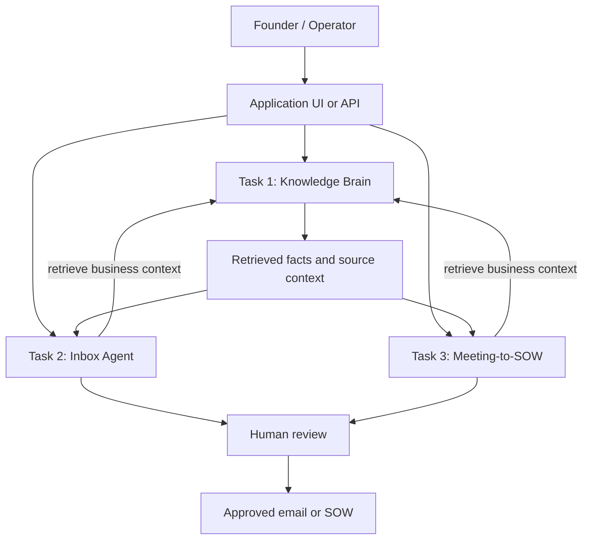

# Design — AI Tech Consultant

## 1. The problem

Small businesses repeat the same technical and administrative work. A founder may answer the same customer questions, read incoming emails, and turn meeting notes into proposals. Each task takes time, and facts can become inconsistent when they are copied between tools.

The goal is not to make an AI sound clever. The goal is to help a small team complete common work faster while keeping business facts consistent and leaving important decisions with a person.

This prototype combines three workflows around one shared Knowledge Brain. The shared layer is important because the inbox and proposal workflows should use the same company facts instead of inventing their own versions.

## 2. Users and success criteria

**Primary user:** a founder or small-business operator who has limited time and does not have a dedicated operations team.

The product should:
- Find relevant facts in supplied business information.
- Make it clear when the supplied information does not answer a question.
- Help process email without sending an unapproved message.
- Turn meeting notes into a structured SOW that a human can edit.
- Make failures visible and keep the workflow understandable.

Success should be measured with test results, not adjectives. The evaluation should track answer correctness and grounding, email classification and draft quality, SOW completeness, response latency, and estimated cost per successful task. The actual results belong in `EVALS.md`.

## 3. The three tasks

### Task 1 — Knowledge Brain

**Why it exists:** both other workflows need reliable access to business-specific facts.

**Responsibilities:** accept business knowledge, retrieve relevant passages for a query, and provide context to the calling workflow. The system should avoid presenting unsupported guesses as known facts.

**Chosen scope:** a simple knowledge ingestion and retrieval path that the other tasks can call through an API.

**Dropped from the initial scope:** complex autonomous web research, automatic updates from every business system, and a full enterprise permissions layer. These add setup and security work before the core retrieval behavior is validated.

### Task 2 — Inbox Agent

**Why it exists:** email triage and drafting are frequent, repetitive tasks, but an incorrect message can damage a customer relationship.

**Responsibilities:** accept an email, identify its intent, use the Knowledge Brain API when business context is needed, and produce a suggested action or reply for review.

**Safety boundary:** the agent should not silently send external messages. A human should approve the final response. If the email asks for a fact that is not in the knowledge base, the system should ask for clarification or flag the missing information.

**Dropped from the initial scope:** autonomous sending, complex multi-inbox synchronization, and handling every attachment format. These would make failures harder to detect and would require additional authorization and integration work.

### Task 3 — Meeting-to-SOW

**Why it exists:** meeting notes often contain scattered requirements, assumptions, and open questions. A proposal built from incomplete notes can create scope disputes later.

**Responsibilities:** accept meeting notes, use the Knowledge Brain API for company context, and draft an SOW with scope, deliverables, assumptions, exclusions, milestones, and open questions where applicable.

**Safety boundary:** the output is a draft, not a binding agreement. Missing prices, deadlines, or commitments must be marked as unknown rather than invented.

**Dropped from the initial scope:** automatic contract execution, legally authoritative language, and automatic pricing commitments. These need business approval and legal or financial review.

## 4. How the tasks connect

The diagram describes the intended logical flow. Update it if the implementation uses different service boundaries or data paths. Task 2 and Task 3 must call Task 1's API; they should not bypass it with separate copies of the knowledge store.

## 5. Model and system choices

The design separates retrieval and application logic from language generation. This makes it possible to change the language model without rewriting every workflow and to test retrieval independently.

For each model used, record the exact provider, model identifier, date tested, configuration, and fallback behavior in `EVALS.md`. Do not write that one model is better unless both models were tested against the same cases.

Model choice should consider:
- **Quality:** correct, grounded, complete output on the task-specific test set.
- **Cost:** measured or provider-calculated cost for the same input and output workload.
- **Speed:** median and p95 latency across repeated runs.
- **Reliability:** timeout rate, invalid output rate, and behavior when information is missing.

A smaller or cheaper model may be enough for straightforward classification. A more capable model may be worth its cost for complex SOW drafting. This is a hypothesis to test, not a result to claim before measurement.

## 6. What can break

| Failure | Impact | Expected handling |
|---|---|---|
| Knowledge base has no relevant fact | Unsupported answer | Say the information is missing; ask for clarification |
| Retrieval returns the wrong passage | Confident but incorrect result | Include source context and test retrieval relevance |
| API is unavailable or times out | Inbox/SOW task cannot get context | Return a clear error; do not pretend retrieval succeeded |
| Email is ambiguous or hostile | Wrong intent or unsafe reply | Flag for human review |
| Meeting notes omit price or deadline | Invented commercial commitment | Mark as unknown or open question |
| Model returns malformed output | UI or downstream processing fails | Validate schema and show a recoverable error |
| Prompt injection appears in email or notes | Untrusted text may try to change agent behavior | Treat supplied content as data, not system instructions |
| API key or customer data is exposed | Security and privacy incident | Keep secrets out of source control; minimize stored data |

## 7. What I would build next

1. **Improve evaluations first.** Run the same fixed test set against each candidate model and save raw outputs, timing, and token/cost data.
2. **Improve source grounding.** Show which business facts support each answer and measure unsupported-claim rates.
3. **Add approval and audit history.** Record who approved an email or SOW and which version was approved.
4. **Harden the API.** Add authentication, rate limits, input limits, timeouts, and structured error responses where missing.
5. **Add realistic integrations only after the core works.** For example, an email provider or meeting transcription integration can be added after sample-data behavior is reliable.

## 8. Scope and honest status

This is a prototype. It can help draft and organize work, but it does not guarantee correctness, completeness, legal suitability, or business outcomes. A successful demo is not evidence of production readiness.

Before submission, replace any design statement that does not match the code. List unfinished features explicitly. Add measured results only after running the tests described in `EVALS.md`.
