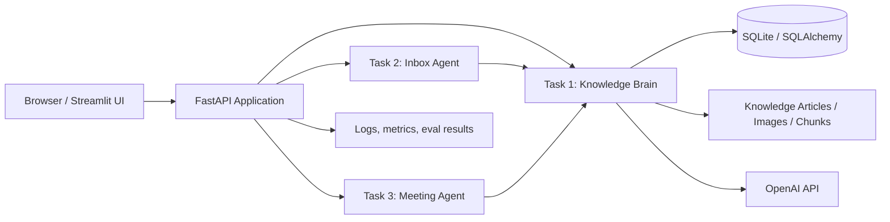

# AI Tech Consultant Capstone Design

## 1. Problem statement
A software services business needs a single AI operating layer to help its team answer product questions, triage incoming customer emails, and convert meetings into client-ready scopes. The solution must keep knowledge current, cite evidence, require human approval for consequential actions, and provide a transparent audit trail for technical interviews and day-to-day operations.

## 2. Proposed architecture
We will build a single Python application with three task modules behind a FastAPI backend and a compact Streamlit UI. The Knowledge Brain is the single source of product truth. Tasks 2 and 3 retrieve product facts from the Brain through the documented HTTP API rather than duplicating retrieval logic.

The system is intentionally monolithic, but modularized by task:
- Browser/UI -> Streamlit dashboard and simple API client
- FastAPI application -> validation, orchestration, SQLAlchemy models, service layer
- Task 1 service -> sitemap-aware ingestion, article extraction, chunking, retrieval, citations, escalations
- Task 2 service -> email classification, evidence retrieval, prompt-based drafting, review workflow
- Task 3 service -> transcript parsing, capability checks, effort estimation, proposal generation
- Shared persistence -> SQLite (development) / PostgreSQL-ready SQLAlchemy setup
- Local vector search -> lightweight SQLite vector metadata store with keyword and metadata indexing (ready for pgvector later)

## 3. Component responsibility matrix
| Component | Responsibility | Key inputs | Key outputs |
|---|---|---|---|
| Web UI | Human review, dashboards, demos | emails, transcripts, query requests | review decisions, status summaries |
| API layer | Validation, schema enforcement, routing | Pydantic models, headers, payloads | JSON responses |
| Knowledge Brain | Ingest product knowledge | sitemap, articles, images | answers, source citations, escalation records |
| Inbox Agent | Classify and draft replies | email payload, Brain API, history | draft reply, approval state |
| Meeting Agent | Turn transcript into scope | transcript, Brain API, capability catalog | requirements, estimates, proposal |
| Persistence | Store docs, drafts, proposals, logs | app entities | durable records and audit history |
| Evaluation harness | Measure quality | evaluation datasets | scorecards, regression checks |

## 4. Database schema
The initial implementation will use SQLite for simplicity and development speed. SQLAlchemy models provide a clean migration path to PostgreSQL later.

Core entities:
- knowledge_document
  - id, source_url, title, canonical_url, content_hash, version, active, deleted_at, ingested_at
- knowledge_section
  - id, document_id, heading, section_order, content
- knowledge_image
  - id, document_id, image_url, caption, description, nearby_text, confidence
- knowledge_chunk
  - id, document_id, section_id, chunk_text, embedding_text, metadata_json
- ingestion_manifest
  - id, source_url, last_seen, last_successful_fetch, status, error_count
- escalation_record
  - id, question, evidence_json, reason, status, created_at, resolved_at
- approved_knowledge_answer
  - id, question, answer, sources_json, approved_by, approved_at, version
- email_message
  - id, email_id, sender, recipient, subject, body, thread_id, timestamp, category, risk, processed_at
- email_draft
  - id, email_id, category, risk, retrieved_knowledge_json, suggested_reply, approval_required, prompt_version, model_id
- review_decision
  - id, draft_id, approved, rejected, replacement_text, correction_reason, reviewer_name, decided_at
- meeting_transcript
  - id, title, source_url, transcript_text, created_at
- meeting_requirement
  - id, transcript_id, requirement_text, category, confidence
- proposal_document
  - id, transcript_id, client_name, scope_summary, estimate_hours, proposal_text, created_at
- evaluator_result
  - id, task_name, case_id, score, notes, created_at, model_name

## 5. API contracts
### Knowledge Brain
- POST /api/v1/query
  - request: {question: str, session_id?: str, strict?: bool}
  - response: {answer, status, sources, relevant_images, request_id, human_escalation_required}
- POST /api/v1/ingestion/run
  - request: {test_batch_only?: bool, limit?: int}
  - response: {ingestion_id, summary, status}
- GET /api/v1/ingestion/status
  - response: {status, pages_processed, pages_failed, last_updated}
- POST /api/v1/escalations
  - request: {question, evidence, reason}
  - response: {id, status}
- GET /api/v1/escalations
  - response: {items: [...]}
- POST /api/v1/escalations/{id}/resolve
  - request: {approved_answer, sources, reviewer}
  - response: {status}
- GET /health
  - response: {status: "ok"}

### Inbox Agent
- POST /api/v1/inbox/process
  - request: {email_id, sender, receiver, subject, body, thread_id, timestamp, previous_messages?}
  - response: {draft, category, risk, human_approval_required, citations}

### Meeting Agent
- POST /api/v1/meetings/process
  - request: {title, transcript_text, client_name?, follow_up_to_id?}
  - response: {requirements, estimate_hours, scope_summary, proposal}

## 6. Main user journeys
1. Knowledge discoverability
   - User asks a product question via UI or API.
   - Brain retrieves relevant text and image notes.
   - Answer includes citations and escalates when evidence is weak.
2. Email triage and response
   - Support inbox receives new email.
   - Agent classifies it and retrieves relevant product facts.
   - Draft is reviewed by a human before sending if fielded as high-risk.
3. Meeting-to-scope workflow
   - Meeting transcript is uploaded.
   - Agent extracts requirements and checks current product capabilities.
   - Proposal is generated with estimated effort and follow-up questions.

## 7. Four-day implementation plan
Day 1
- Confirm requirements and repository state.
- Create design and API contracts.
- Scaffold FastAPI + Streamlit app and shared configuration.
- Define SQLAlchemy models and database bootstrap.
Day 2
- Implement Knowledge Brain ingestion, extraction, retrieval, and API endpoints.
- Create sample seed docs and initial evaluation questions.
Day 3
- Implement Inbox Agent classification/draft workflow and review UI.
- Add the synthetic email dataset and evaluation harness.
Day 4
- Implement Meeting Agent transcript-to-requirements flow and proposal generation.
- Run the evaluation suite, fix failures, and document final trade-offs.

## 8. Risk register
| Risk | Impact | Mitigation |
|---|---|---|
| External site rate-limits | Crawl may fail or be slow | Limit concurrency, add backoff, respect robots, resume state |
| OpenAI API unavailable | Live chat responses are unavailable | Keep knowledge retrieval available and label fallback responses clearly |
| Weak retrieval quality | Hallucinated answers | Require citations and answer with insufficient-evidence status |
| Human approval bottleneck | Slower support operations | Keep low-risk categories eligible for autonomous send with explicit policy |
| Fake or stale data in evaluation sets | Misleading measurements | Keep datasets versioned and clearly marked synthetic |

## 9. Evaluation plan
We will evaluate at least 20 representative cases for each major component, with clear expected outcomes and fixed JSON outputs:
- Task 1: 20 knowledge questions over product docs and image notes
- Task 2: 20 email classification and draft-validation cases
- Task 3: 20 transcript-to-scope and proposal cases
- Model-selection decision: compare at least two OpenAI model configurations using 20-30 cases each

We will score:
- answer correctness
- citation completeness
- email category accuracy
- required human approval accuracy
- proposal completeness and requirement extraction
- latency and cost

## 10. Required environment variables
- OPENAI_API_KEY
- OPENAI_MODEL
- APP_ENV
- DATABASE_URL
- SECRET_KEY
- ALLOWED_ORIGINS
- CRAWL_RATE_LIMIT_SEC
- CRAWL_MAX_CONCURRENCY
- LOG_LEVEL
- UI_HOST
- UI_PORT

## 11. Assumptions and deferred features
Assumptions:
- Local SQLite is sufficient for demo and validation.
- Product knowledge will be represented by seeded sample documentation plus crawlable public articles.
- External website access is available during the capstone run.
- OpenAI credentials may be absent in local development; a clearly labeled retrieval-only fallback keeps the demo functional.

Deferred features:
- Real email provider integration (SMTP/Microsoft Graph) for live sending
- Full enterprise ticketing workflow
- Production-ready pgvector deployment
- True multi-tenant authorization
- Large-scale article indexing beyond the demo corpus

## 12. Mermaid architecture diagram

## 13. Implementation stance
This project is a production-minded proof of concept. It is not a mockup-only example. The code will include durable persistence, validation, typed models, test datasets, and a reviewable workflow with explicit human approval gates.
